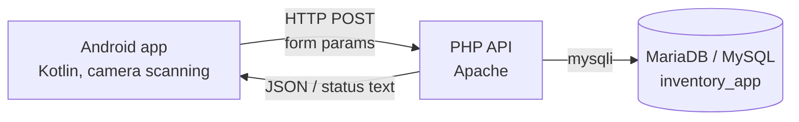
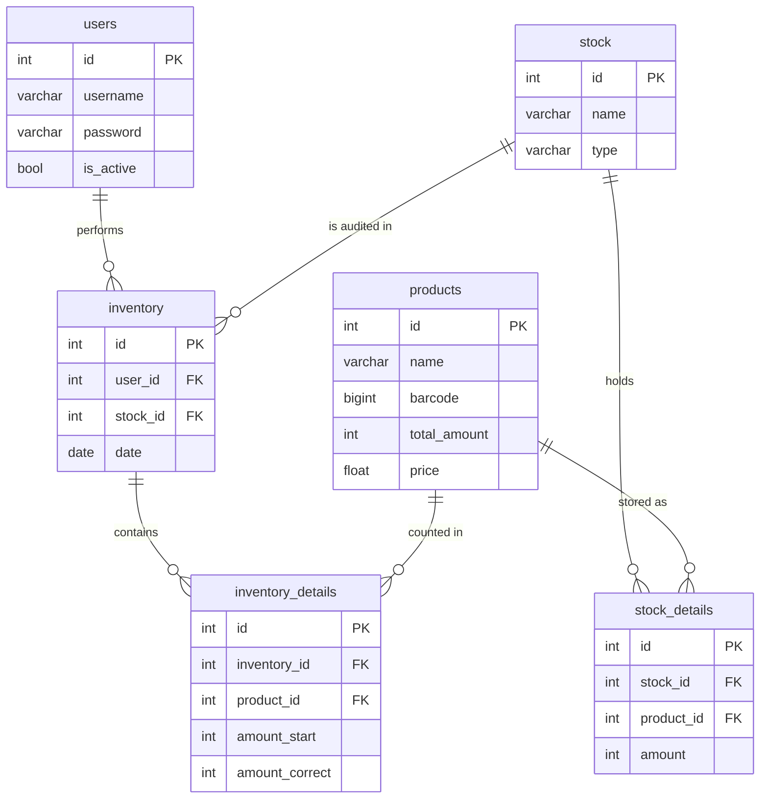

# Inventory App — Mobile Stock-Taking with Barcode Scanning

Engineering thesis project (Wrocław University of Science and Technology) focused on **mobile stock-taking in warehouses, production areas and at subcontractors** — replacing paper count sheets with a single on-device workflow: **scan → verify → correct**, with every change written straight to the central database.

The repository contains a complete client–server system that:

1. provides an **Android application written in Kotlin** with live camera barcode scanning and two stock-taking modes,
2. exposes a **lightweight PHP API** for authentication, product lookup and stock correction,
3. defines a **relational MySQL/MariaDB database** for products, locations, per-location stock levels, users and stock-take history,
4. runs entirely on a **local network**, so the server address is entered on the phone at login.

---

## Key features

### Stock-taking modes

| Mode | How it works | Typical use |
|---|---|---|
| **Fast barcode inventory** | Pick a location, scan any product, see the expected quantity at that location and correct it in one tap | Ad-hoc checks, quick corrections |
| **Complex (guided) inventory** | The app goes through the products assigned to a location one by one; the quantity can be edited only after the scanned barcode matches the expected item | Full counts, spot checks |

In the guided mode the user chooses the scope of the count:

| Scope | Description |
|---|---|
| All products | Every product stored at the selected location |
| Random sample | N randomly chosen products from that location (cycle counting) |

### Other features

- **Login against the central database.** Credentials are stored in the `users` table, and the password is hashed on the device before it is sent.
- **Consistent stock levels.** A correction updates the quantity at the given location and adjusts the product's company-wide `total_amount` by the same difference, so per-location and global stock always match.
- **One model for all location types.** Warehouses, production lines and subcontractors share the same tables, so a new location type needs no schema changes.
- **Live camera scanning** with continuous autofocus and support for all common 1D/2D formats (EAN-13, EAN-8, Code 128, QR and others).
- **Material Design UI** with a navigation drawer, fragments and runtime camera permission handling.

> **Note:** the scan-before-edit rule in the guided mode is a deliberate safety check. It stops the user from correcting the quantity of the wrong product, which is one of the most common mistakes in manual stock-taking.

---

## Architecture



| Layer | Responsibility |
|---|---|
| **Android client** | UI, camera and barcode detection, inventory session state, input validation |
| **PHP API** | Thin endpoint scripts plus one `DataBase` class with all data-access logic |
| **Relational database** | Products, locations, per-location stock, users, stock-take history |

### API endpoints (`Android/`)

| Endpoint | Purpose |
|---|---|
| `login.php` | authenticates a user |
| `signup.php` | registers a new user |
| `getTableList.php` | returns the rows of a table (e.g. the list of locations) |
| `getInventoryTargetData.php` | resolves a location name to its record |
| `getProductsFromInventoryTarget.php` | lists the products stored at a location |
| `findProduct.php` | finds a product by barcode or ID, together with its quantity at a location |
| `correctProductAmount.php` | saves a counted quantity and updates the global stock total |

### Data model



- `stock` stores every type of location (`warehouse`, `production`, `subcontractor`).
- `stock_details` holds the quantity of each product at each location.
- `inventory` and `inventory_details` are designed to record the history of stock-takes:
  - who counted and where,
  - when the count took place,
  - quantities before and after correction.
- Foreign keys and unique constraints on barcodes, product names, location names and usernames keep the data consistent.

---

## Tech stack

**Kotlin** · **Android SDK** (min API 28, target API 34) · ViewBinding · Material Components · Kotlin Coroutines · **Google Mobile Vision** (barcode detection) · Gson · HttpURLConnection · **PHP 8.2** · Apache · **MariaDB 10.4 / MySQL** · phpMyAdmin · Git / GitLab (issue-driven workflow with merge requests)

---

## Project structure

```
├── Android/                     # PHP API
│   ├── DataBase.php             # data-access class: login, product lookup, stock correction
│   ├── DataBaseConfig.php       # database connection settings
│   └── *.php                    # endpoint scripts called by the app
├── inventory_app.sql            # database schema with sample data
└── src/                         # Android Studio project (Gradle)
    └── app/src/main/
        ├── java/com/example/inventoryapp/
        │   ├── MainActivity.kt                    # login screen
        │   ├── Menu.kt                            # navigation drawer host
        │   ├── StartFastInventoryFragment.kt      # fast inventory setup
        │   ├── StartComplexInventoryFragment.kt   # guided inventory setup (all / random sample)
        │   ├── FastInventory.kt                   # scan-and-correct screen
        │   ├── ComplexInventory.kt                # guided, scan-verified counting screen
        │   ├── fun.kt                             # shared API calls and helpers
        │   └── Config.kt                          # session state and Product model
        └── res/                                   # layouts, strings, themes, icons
```

---

## Getting started

### Environment

The server side runs on a local web stack with Apache, PHP and MySQL/MariaDB (e.g. XAMPP):

```bash
mysql -u <user> -p -e "CREATE DATABASE inventory_app"
mysql -u <user> -p inventory_app < inventory_app.sql
cp -r Android/ <web-server-document-root>/
```

Then set the database host and credentials in `Android/DataBaseConfig.php`.

The mobile app is a standard Gradle project — open `src/` in Android Studio, or build from the command line:

```bash
cd src
./gradlew installDebug
```

### Typical workflow

```bash
# 1. Start Apache and MariaDB on the server machine
# 2. Make sure the phone is connected to the same network as the server
# 3. Launch the app and enter the server IP on the login screen, e.g. 192.168.0.201
# 4. Choose "Fast barcode inventory" or "Complex inventory" from the navigation drawer
# 5. Select a warehouse / production area / subcontractor and press Start
# 6. Scan products, enter the real quantities and press Apply changes
```

> The test setup used a static local network: server `192.168.0.201`, phone `192.168.0.202`, mask `255.255.255.0`, gateway `192.168.0.1`.

---

## Author

**Marcin Dorożyński** — BEng thesis, Wrocław University of Science and Technology (2023)
